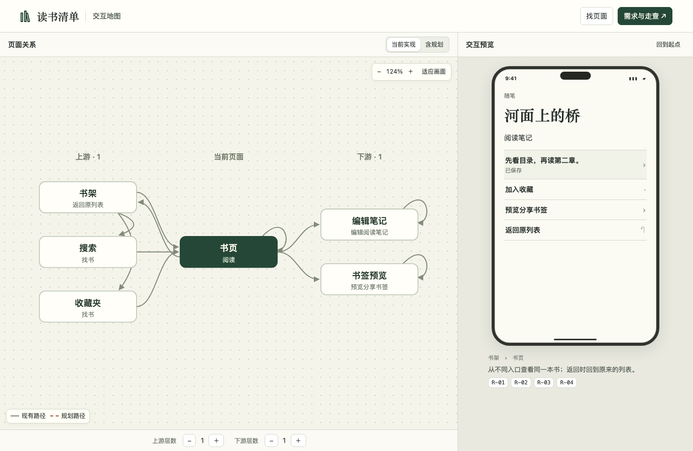

# Interaction Atlas · 应用交互地图

一个可分享的 Agent Skill。把任意应用里散落的页面、按钮、返回逻辑和需求依据，整理成一张可以点、可以推演、可以跟代码一起做版本管理的地图。

**左边看一个页面从哪来、能去哪；右边操作同一条流程。** 选一条需求，还能看到涉及的页面、受影响的入口，以及值得重新走一遍的路径。

[在线体验读书清单示例](https://indecreasy.github.io/interaction-atlas-skill/assets/starter/) · [理解架构](references/architecture.md) · [接入自己的代码和需求库](references/connect-a-project.md)



## 先用一分钟试试看

打开上面的在线示例，或下载本仓库后直接打开 [assets/starter/index.html](assets/starter/index.html)。离线示例使用原生 HTML、CSS 和 JavaScript，无需安装依赖。

1. 在左侧点一个页面，观察它的上游和下游，再点加号展开一层。拖动空白处可以移动画布，缩放后仍然是同一张图。
2. 从不同入口进入同一本书，再点返回。观察同一个详情页如何回到各自的入口。试着修改笔记，分别取消和保存。
3. 打开需求影响分析，选一条路径逐步走查。切换到规划层，看看尚未实现的流程会出现在哪里。

## 把 Skill 用到你的项目

**以 Codex 为例**，将本仓库克隆到个人技能目录下的 `interaction-atlas` 文件夹，然后打开目标项目并新开一个会话。

```sh
mkdir -p ~/.agents/skills
git clone https://github.com/indecreasy/interaction-atlas-skill.git ~/.agents/skills/interaction-atlas
```

在对话里可以直接这样说：

> 用 $interaction-atlas 梳理这个项目。代码在当前仓库，需求在我提供的工单导出表里。先做“从提醒进入详情，修改后保存或取消”这一条。左边让我看上下游，右边让我点实际流程，点动作能查回工单。保留原工单编号和状态。

其他支持 `SKILL.md` 的工具，可把本仓库放到其技能目录。也可以把 [SKILL.md](SKILL.md) 交给你的编码助手，同时提供 `references/` 和 `assets/`。

## 我需要更改现有代码或需求库吗？

可以继续用原来的框架、需求编号和开发状态。Skill 会先找真实入口、导航和回调，然后把行为整理为“页面 → 动作 → 结果”，再关联已有需求。需求可以来自 Markdown、表格、GitHub Issues、Jira、Linear、Notion 或自建系统；使用已有导出或已授权的数据来源。仓库提供离线网页模板，不附带第三方账号连接器。

没有需求库也能从代码开始，尚未查明的归属标记为待关联。如果手头只有设计稿和需求，则先推演规划流程。读书清单的书名、界面和需求编号都只属于示例。

## 想自己搭一张地图

在本仓库目录执行，目标使用一个新目录：

```sh
python3 scripts/new_atlas.py ../my-project/interaction-map
```

打开生成目录里的 `index.html`。先修改 `model.js` 的页面、动作与需求，再替换预览布局及依据文档。一条需求可以关联多个页面，一个动作也可以有多个依据。

| 想改什么 | 从哪里开始 |
| --- | --- |
| 哪些页、哪些动作、归属哪个需求 | [示例模型](assets/starter/model.js) |
| 进入、返回、同页变化、规划层与影响路径 | [导航与推导逻辑](assets/starter/core.js) |
| 上下游布局、手机预览、逐步走查 | [示例界面](assets/starter/view.js) |
| 现有项目如何接入，包括没有标准需求编号的情况 | [项目接入指南](references/connect-a-project.md) |
| 为什么返回要看进入历史，如何防止图和 Demo 各跑各的 | [架构说明](references/architecture.md) |

## 验证和版本管理

在仓库根目录运行 `node tests/check.mjs` 验证自带示例。替换为自己的数据后，运行 `node tests/check.mjs ../my-project/interaction-map` 检查生成的地图。网页回放能检查已建模动作和状态；产品的权限弹窗、系统返回、真实保存等行为，需要在实际产品中核对。将你生成的地图放进目标项目，修改交互时一并更新模型、需求依据和对应的走查。团队就能按需求编号在 Git 中查到行为何时改变。

本项目使用 [MIT 许可证](LICENSE)，可复制、修改并用于自己的项目。
